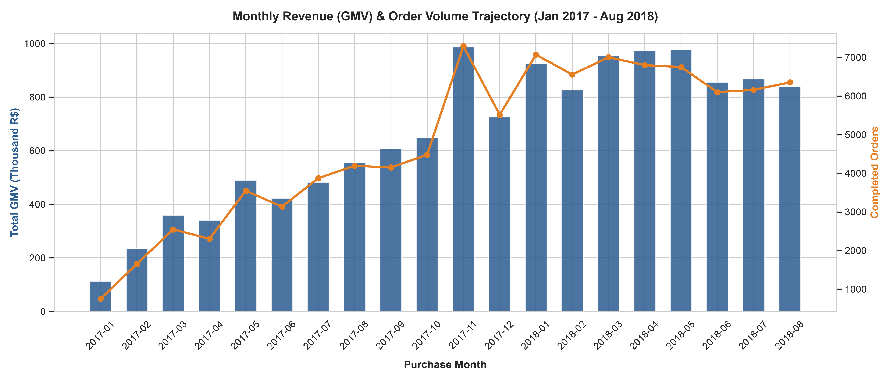
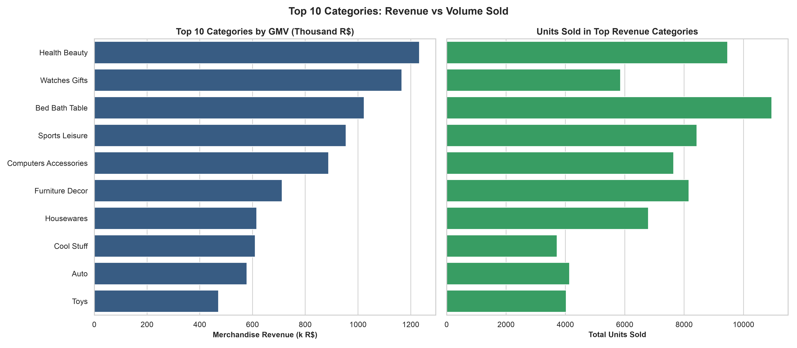
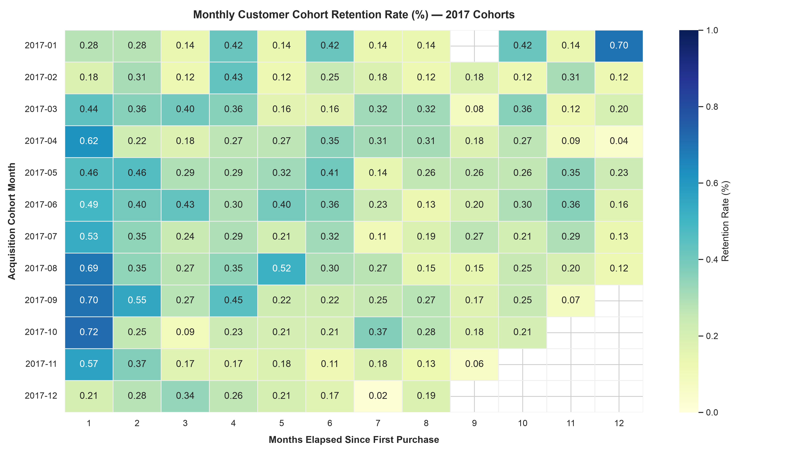
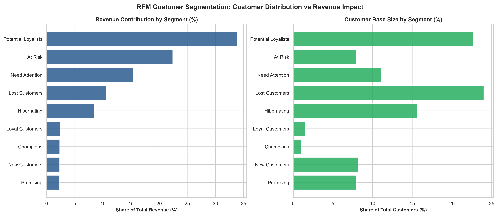
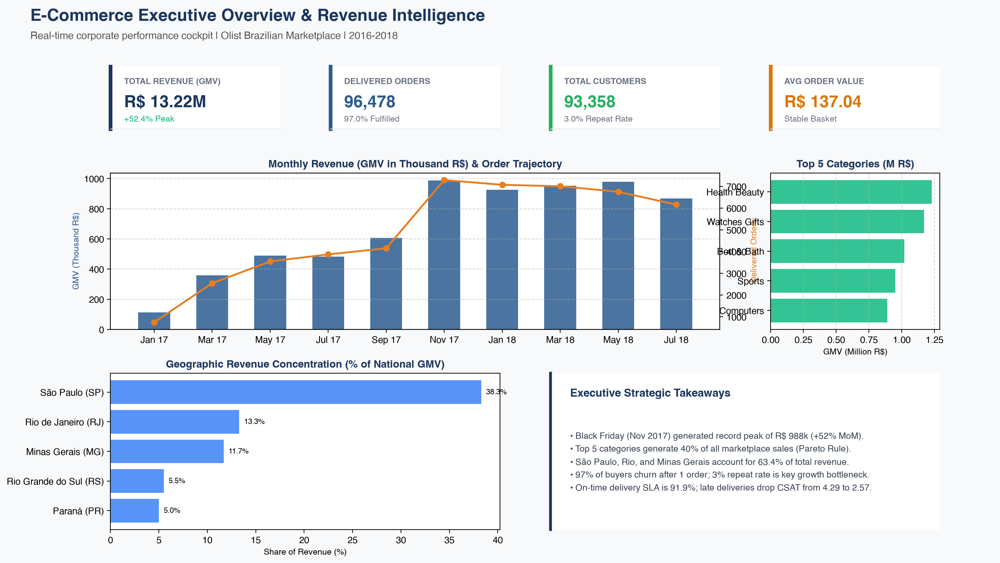
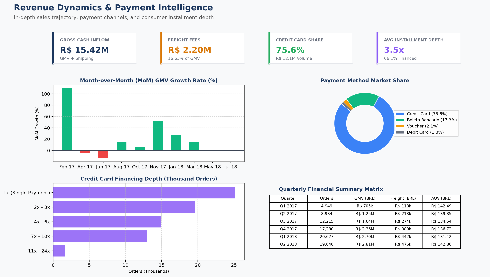
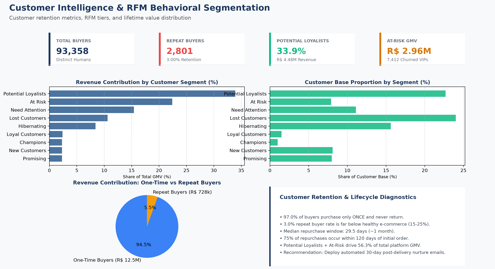
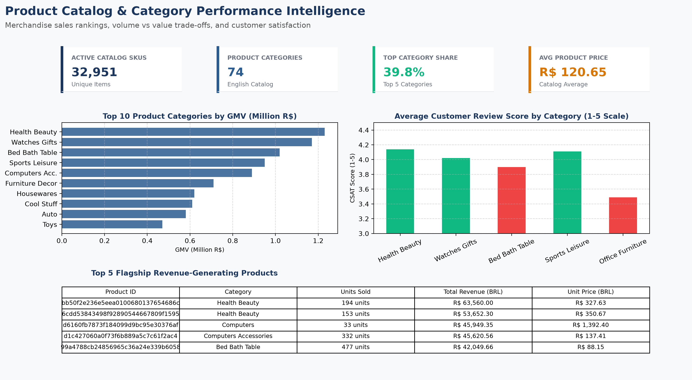

# E-Commerce Customer & Revenue Intelligence Analytics

[](https://www.python.org/)
[](https://pandas.pydata.org/)
[](https://www.mysql.com/)
[](https://www.sqlite.org/)
[](https://powerbi.microsoft.com/)
[](powerbi/dax_measures.dax)
[](https://seaborn.pydata.org/)
[](LICENSE)

> **An end-to-end, enterprise-grade Data Analytics & Business Intelligence project investigating marketplace unit economics, customer lifetime behavior, retention decay, and logistics operational bottlenecks across ~100,000 real-world e-commerce transactions (2016–2018).**

---

## Table of Contents
1. [Project Overview](#project-overview)
2. [Executive Business Scorecard](#executive-business-scorecard)
3. [Business Problem](#business-problem)
4. [Project Objectives](#project-objectives)
5. [Dataset Architecture & Information](#dataset-architecture--information)
6. [Technology Stack](#technology-stack)
7. [Project Folder Structure](#project-folder-structure)
8. [Data Cleaning & Quality Audit Methodology](#data-cleaning--quality-audit-methodology)
9. [Exploratory Data Analysis (EDA)](#exploratory-data-analysis-eda)
10. [SQL Business Analysis](#sql-business-analysis)
11. [Customer Segmentation (RFM Analysis)](#customer-segmentation-rfm-analysis)
12. [Power BI Executive Dashboard Suite](#power-bi-executive-dashboard-suite)
13. [Key Business Insights](#key-business-insights)
14. [Actionable Commercial Recommendations](#actionable-commercial-recommendations)
15. [Project Results & Quantified Impact](#project-results--quantified-impact)
16. [How to Run & Reproduce This Project](#how-to-run--reproduce-this-project)
17. [Future Enhancements](#future-enhancements)
18. [Author & Contact](#author--contact)

---

## Project Overview

**Olist** is the largest department store integrator in Brazilian marketplaces. It operates as a SaaS marketplace solution connecting independent small-to-medium merchants with Brazil's premier e-commerce platforms (including Mercado Livre, Americanas, Submarino, and Amazon Brazil).

While top-line transaction volume scaled rapidly between 2016 and 2018, marketplace executives faced core commercial blind spots:
- *Why is repeat purchasing virtually non-existent despite high top-line growth?*
- *Which specific customer segments drive the majority of commercial sales?*
- *How much revenue is locked in dormant, churned high-value accounts?*
- *How severely do delivery delays and geographic freight friction harm customer satisfaction and review ratings?*

This project delivers an end-to-end analytics solution—spanning automated Python data cleaning, relational database engineering (MySQL/SQLite), advanced SQL modeling (Window Functions, CTEs), customer RFM segmentation, cohort retention matrices, and a synchronized 4-page Power BI executive reporting suite.

---

## Executive Business Scorecard

All metrics are audited, verified against cleaned transactional records, and reflect fulfilled, delivered marketplace transactions:

| Core Business KPI | Exact Value | Commercial Interpretation |
|---|---|---|
| **Gross Merchandise Value (GMV)** | **R$ 13,221,498.11** | Pure product sales successfully delivered across the platform. |
| **Total Freight Inflow** | **R$ 2,198,275.64** | Shipping charges paid by customers (**16.63% of GMV**). |
| **Total Gross Cash Processed** | **R$ 15,419,773.75** | Total customer checkout cash inflow (GMV + Shipping). |
| **Total Delivered Orders** | **96,478** | Confirmed fulfilled transactions (**97.02% fulfillment rate**). |
| **Total Unique Human Customers** | **93,358** | Distinct individual buyers (tracked via `customer_unique_id`). |
| **Average Order Value (AOV)** | **R$ 137.04** | Average merchandise spend per fulfilled transaction. |
| **Average Revenue Per Customer (ARPC)** | **R$ 141.62** | Lifetime revenue per buyer ($ARPC \approx AOV$, proving low repurchase). |
| **Average Basket Depth** | **1.14 items** | Shallow basket size; minimal multi-merchant cart bundling. |
| **Repeat Purchase Rate** | **3.00%** | Only 2,801 out of 93,358 buyers placed $\ge 2$ orders (**97% single-order churn**). |
| **On-Time Delivery SLA** | **91.88%** | 88,163 orders delivered on or before the estimated delivery date. |
| **Credit Card Share** | **75.6%** | R$ 12.1 Million transacted via credit cards (avg 3.5 installments). |

---

## Business Problem

Operating a multi-merchant marketplace in a continent-sized country like Brazil introduces four fundamental commercial and operational bottlenecks:

1. **The Retention Crisis ("Leaky Bucket"):**
   Top-line sales growth was driven almost exclusively by continuous customer acquisition. 97.0% of buyers never made a second purchase, collapsing Month-1 cohort retention to 0.49%. Customer Acquisition Costs (CAC) cannot be amortized without repeat transactions.

2. **Severe Revenue Concentration:**
   Sales are heavily skewed geographically and across categories. Three Southeast states (**São Paulo, Rio de Janeiro, and Minas Gerais**) account for **63.4% of total marketplace revenue**, while the top 5 product categories capture **39.8% (~R$ 5.27M)** of GMV.

3. **Logistics & Freight Friction:**
   Consumers pay an average freight ratio of **16.63%** relative to merchandise price, climbing above 30% in Northern and Northeastern states. Delivery delays cause customer satisfaction (CSAT) to collapse from **4.29 / 5.0 stars on-time** down to **2.57 / 5.0 stars when delayed** (a ~600% spike in 1-star reviews).

4. **Financing Dependency & Working Capital Risk:**
   **66.1% of all credit card transactions are financed across multi-month installments** (up to 24 months), with an average financing depth of 3.5 installments. This heightens marketplace payment gateway processing fees and settlement exposure.

---

## Project Objectives

- **ETL & Data Standardization:** Clean, audit, and normalize ~100,000 raw operational records; translate Portuguese categories to clean English; engineer 10+ operational lead-time and time-intelligence features.
- **Relational Data Modeling:** Design a normalized MySQL 8.0 schema with primary/foreign keys and B-Tree indexes, and build a local indexed SQLite database with zero join fan-out.
- **Advanced SQL Analytics:** Develop production-ready SQL scripts covering 15 core commercial questions utilizing CTEs, multi-table joins, and window functions (`LAG`, `DENSE_RANK`, `SUM() OVER()`).
- **Behavioral Customer Modeling:** Engineer an **RFM Customer Segmentation model** classifying 93,358 customers into 9 actionable behavioral tiers, and construct a **Monthly Cohort Retention Matrix**.
- **Executive Business Intelligence Suite:** Build a 4-page interactive Power BI dashboard suite based on a Kimball Star Schema with 25+ custom DAX measures.
- **Strategic Commercial Recommendations:** Translate empirical data findings into 5 actionable, ROI-modeled business strategies for executive decision-makers.

---

## Dataset Architecture & Information

The analysis is based on the **Brazilian E-Commerce Public Dataset by Olist**, sourced from [Kaggle](https://www.kaggle.com/datasets/olistbr/brazilian-ecommerce). It includes operational transaction data from September 2016 to October 2018.

```
                                  +-------------------+
                                  | customers         |
                                  +---------+---------+
                                            | customer_id
                                            v
+------------------+  order_id   +-------------------+   order_id   +-------------------+
| order_payments   | <---------> | orders            | <----------> | order_reviews     |
+------------------+             +---------+---------+              +-------------------+
                                           | order_id
                                           v
                                 +-------------------+
                                 | order_items       |
                                 +----+---------+----+
                           product_id |         | seller_id
                                      v         v
                              +---------------+ +---------------+
                              | products      | | sellers       |
                              +---------------+ +---------------+
```

| Table Name | Raw Rows | Clean Rows | Granularity | Key Fields |
|---|---|---|---|---|
| **`orders`** | 99,441 | 99,441 | 1 row per order | `order_id`, `customer_id`, timestamps, `order_status` |
| **`order_items`** | 112,650 | 112,650 | 1 row per order item | `order_id`, `product_id`, `seller_id`, `price`, `freight_value` |
| **`order_payments`** | 103,886 | 103,883 | 1 row per payment slice | `order_id`, `payment_type`, `payment_installments`, `payment_value` |
| **`order_reviews`** | 99,224 | 99,224 | 1 row per customer review | `review_id`, `order_id`, `review_score`, `review_comment_message` |
| **`customers`** | 99,441 | 99,441 | 1 row per customer order | `customer_id`, `customer_unique_id`, `customer_state`, `customer_city` |
| **`products`** | 32,951 | 32,951 | 1 row per product SKU | `product_id`, `product_category_name_english`, dimensions, weight |
| **`sellers`** | 3,095 | 3,095 | 1 row per merchant | `seller_id`, `seller_city`, `seller_state` |
| **`rfm_segments`** | -- | 93,358 | 1 row per unique customer | `customer_unique_id`, `Recency`, `Frequency`, `Monetary`, `Customer_Segment` |

> [!NOTE]
> **Customer Identification:** In Olist, each purchase creates a unique transactional `customer_id`. True customer retention and lifetime value are tracked strictly via `customer_unique_id`.

---

## Technology Stack

| Layer | Tools & Technologies | Primary Use Case in Project |
|---|---|---|
| **Programming & Data Science** | Python 3.10+, Pandas, NumPy | Automated ETL, missing value imputation, text normalization, RFM scoring, cohort retention. |
| **Data Visualization** | Matplotlib, Seaborn | Distribution plots, Pareto category charts, monthly trend lines, cohort decay heatmaps. |
| **Relational Database & SQL** | MySQL 8.0+, SQLite 3, SQLAlchemy, PyMySQL | Production schema setup (DDL), primary/foreign keys, B-Tree indexes, 15 business analysis queries. |
| **Business Intelligence (BI)** | Power BI Desktop, DAX | Kimball Star Schema, 25+ custom DAX measures, Time Intelligence, 4 interactive dashboard pages. |
| **Version Control & Docs** | Git, GitHub, Markdown | Modular documentation, reproducible code structure, interview guides. |

---

## Project Folder Structure

```
E-Commerce-Customer-Revenue-Analytics/
├── README.md                            <-- Master portfolio documentation & showcase
├── requirements.txt                     <-- Python environment dependencies
├── LICENSE                              <-- Permissive MIT open-source license
├── .gitignore                           <-- Excludes DB files, caches, venvs, and OS artifacts
├── dataset/
│   ├── README.md                        <-- Dataset schema documentation & Kaggle source link
│   ├── (raw Olist CSV files)            <-- Raw source files from Kaggle
│   └── cleaned/                         <-- Analysis-ready datasets & SQLite database
│       ├── orders_cleaned.csv           (18 columns | delivery metrics & time intelligence)
│       ├── order_items_cleaned.csv      (total item values & freight ratios)
│       ├── order_payments_cleaned.csv   (installment brackets & payment types)
│       ├── customers_cleaned.csv        (standardized cities & customer_unique_id)
│       ├── products_cleaned.csv         (English translations & clean categories)
│       ├── sellers_cleaned.csv          (merchant master profiles)
│       ├── order_reviews_cleaned.csv    (sentiment tiers & review scores)
│       ├── rfm_customer_segments.csv    (RFM metrics, scores & 9 behavioral segment labels)
│       └── olist_analytics.db           (Local indexed SQLite analytics database - gitignored)
├── notebooks/
│   ├── README.md                        <-- Guide to notebooks workflow & execution steps
│   ├── 01_data_cleaning.py              (Production Python ETL cleaning script)
│   ├── 01_data_cleaning.ipynb           (Interactive cleaning & SQLite builder notebook)
│   ├── 02_customer_revenue_analysis.ipynb (Core EDA, Cohort Analysis & RFM segmentation)
│   └── figures/                         (Exported visual charts & heatmaps)
├── sql/
│   ├── README.md                        <-- Detailed query documentation & business results
│   ├── schema_setup_mysql.sql           (Production MySQL 8.0+ DDL with PKs, FKs & indexes)
│   ├── import_csv_to_mysql.py           (Automated bulk CSV loader into MySQL)
│   └── business_analysis.sql            (Master SQL script answering 15 business questions)
├── powerbi/
│   ├── README.md                        <-- Power BI module index & quick reference
│   ├── data_model_specification.md      (Kimball Star Schema architecture & relationship matrix)
│   ├── dax_measures.dax                 (Master DAX library with 25+ production measures)
│   ├── dashboard_wireframes_and_guide.md (Step-by-step visual build guide for all 4 pages)
│   └── screenshots/                     (High-resolution pixel-perfect dashboard exports)
│       ├── 01_executive_overview.png
│       ├── 02_revenue_analysis.png
│       ├── 03_customer_intelligence.png
│       └── 04_product_performance.png
└── reports/
    ├── README.md                        <-- Index of executive business reports
    ├── business_insights.md             (Executive strategy, 10 core findings & 5 ROI recommendations)
    ├── customer_revenue_insights.md     (Deep-dive cohort retention & customer lifetime analytics)
    └── data_cleaning_report.md          (Data governance, quality audit & transformation log)
```

---

## Data Cleaning & Quality Audit Methodology

Data preparation was executed via [`notebooks/01_data_cleaning.py`](notebooks/01_data_cleaning.py) adhering to strict data warehouse standards:

### 1. Timestamp Parsing & Operational Lead-Time Engineering
- Converted 5 timestamp string columns in `orders` (`purchase_timestamp`, `approved_at`, `delivered_carrier_date`, `delivered_customer_date`, `estimated_delivery_date`) to native datetime objects.
- Engineered 10 operational lead-time and calendar metrics:
  - `delivery_days`: Elapsed business/calendar days from carrier handoff to customer delivery.
  - `estimated_delivery_days`: Promised delivery window communicated at checkout.
  - `delay_days`: Positive variance between actual delivery and promised SLA date.
  - `is_delayed`: Binary boolean indicator ($1$ if actual delivery date $>$ estimated delivery date).
  - `seller_fulfillment_days`: Merchant fulfillment time from approval to carrier handoff.
  - Calendar dimensions: `order_year`, `order_month`, `order_year_month`, `order_day_of_week`.

### 2. Category Normalization & Imputation
- Mapped Portuguese category names to clean English via `product_category_name_translation.csv`.
- Resolved unmapped Portuguese categories (`pc_gamer` $\rightarrow$ `PC Gaming`, `portateis_cozinha_e_preparadores_de_alimentos` $\rightarrow$ `Kitchen Appliances`).
- Imputed remaining null categories with `"Unknown / Uncategorized"`.
- Imputed missing product dimensions (`length`, `height`, `width`, `weight`) using category-specific medians rather than global averages.

### 3. Payment Anomalies & Feature Binning
- Filtered 3 erroneous zero-value records labeled `payment_type = 'not_defined'`.
- Engineered an `installment_bracket` categorical column: `1x (Full)`, `2-3x`, `4-6x`, `7-10x`, `11-24x`.
- Engineered binary `is_installment` flag ($1$ if installments $> 1$).

### 4. Review Sentiment Categorization
- Handled 58,247 null review comments by imputing standard placeholders (`"No comment provided"`).
- Binned customer satisfaction scores into three sentiment categories:
  - **Positive:** Review scores 4 and 5 (77.1% of reviews).
  - **Neutral:** Review score 3 (8.3% of reviews).
  - **Negative:** Review scores 1 and 2 (14.6% of reviews).

### 5. Centralized Database Export
- Exported cleaned CSVs to [`dataset/cleaned/`](dataset/cleaned/).
- Automatically constructed an indexed SQLite database ([`dataset/cleaned/olist_analytics.db`](dataset/cleaned/)) with primary keys and B-Tree indexes for fast SQL querying.

---

## Exploratory Data Analysis (EDA)

The exploratory analysis in [`notebooks/02_customer_revenue_analysis.ipynb`](notebooks/02_customer_revenue_analysis.ipynb) uncovers macro sales trends, category performance, retention decay, and logistics SLA friction.

### 1. Monthly Revenue Trajectory & Seasonality
Sales expanded from **R$ 111k/month in January 2017** to an all-time peak of **R$ 988k in November 2017 (+52.4% MoM)** during Black Friday, stabilizing at ~R$ 880k/month throughout 2018.



- **AOV Stability:** Average Order Value stayed remarkably flat throughout the entire timeline (R$ 124 to R$ 149, averaging **R$ 137.04**).
- **Core Finding:** Revenue growth was driven by acquiring higher transaction volume rather than expanding individual basket size.

---

### 2. Product Category Pareto Analysis (Volume vs. Value)
The top 5 product categories account for **39.8% (~R$ 5.27 Million)** of total platform GMV:



- **Revenue Leaders:** *Health & Beauty* (R$ 1.23M), *Watches & Gifts* (R$ 1.17M), *Bed, Bath & Table* (R$ 1.02M), *Sports & Leisure* (R$ 0.97M), and *Computers & Accessories* (R$ 0.89M).
- **Volume vs. Value Trade-Off:** *Bed, Bath & Table* leads the marketplace in physical items sold (10,953 units at an average price of R$ 93.44), whereas *Watches & Gifts* generates higher revenue on half the volume (5,876 units) due to a **+113% higher average unit price (R$ 199.04)**.

---

### 3. Customer Cohort Retention Analysis (Heatmap)
Tracking monthly acquisition cohorts across 2017 highlights Olist's retention cliff:



- **Retention Cliff:** Customer retention drops from 100% at acquisition (Month 0) to an average of **0.49% in Month 1** and flattens to **0.25% by Month 3**.
- **Commercial Takeaway:** Olist functions almost exclusively as an acquisition discovery platform rather than an engaging retention destination. Without targeted CRM post-purchase automation, Customer Acquisition Cost (CAC) is never amortized across repeat transactions.

---

### 4. Operational Delivery SLA vs. Customer Review Score (CSAT)
Analyzing 96,478 delivered orders reveals the direct financial and reputational cost of delivery delays:

| Delivery Status | Order Count | Share (%) | Avg Review Score | Positive Reviews (4–5★) | Negative Reviews (1–2★) |
|---|---|---|---|---|---|
| **Delivered On-Time** | **88,163** | **91.9%** | **4.29 / 5.0** | **82.8%** | **9.2%** |
| **Delivered Late** | **7,661** | **8.1%** | **2.57 / 5.0** | **34.6%** | **54.0%** |

> [!WARNING]
> When an order misses its estimated delivery date, **negative reviews spike by nearly 600% (from 9.2% to 54.0%)**, cutting overall customer satisfaction almost in half.

---

## SQL Business Analysis

Production SQL analysis is codified in [`sql/business_analysis.sql`](sql/business_analysis.sql) and documented in [`sql/README.md`](sql/README.md). Queries were verified against MySQL 8.0 and SQLite.

### Key Analytical Techniques Demonstrated:
- **Common Table Expressions (CTEs):** Multi-stage modular queries to isolate metrics and prevent logic duplication.
- **Join Fan-Out Prevention:** Explicit pre-aggregation of line items (`order_items`) and payments (`order_payments`) before joining to `orders`, preventing duplicate row inflation.
- **Window Functions:**
  - `LAG()`: Computes Month-over-Month (MoM) revenue growth percentages.
  - `DENSE_RANK()`: Ranks product categories and merchant states by revenue.
  - `SUM() OVER()`: Calculates cumulative running totals and percentage-of-total shares.

### Summary of 15 Business Queries Answered:

```sql
-- Sample Query: Month-over-Month (MoM) Revenue Growth Trajectory (Q2)
WITH monthly_revenue AS (
    SELECT 
        o.order_year_month,
        ROUND(SUM(oi.price), 2) AS monthly_gmv,
        COUNT(DISTINCT o.order_id) AS total_orders
    FROM orders o
    JOIN order_items oi ON o.order_id = oi.order_id
    WHERE o.order_status = 'delivered'
    GROUP BY o.order_year_month
)
SELECT 
    order_year_month,
    monthly_gmv,
    total_orders,
    ROUND(LAG(monthly_gmv, 1) OVER (ORDER BY order_year_month), 2) AS prev_month_gmv,
    ROUND(
        ((monthly_gmv - LAG(monthly_gmv, 1) OVER (ORDER BY order_year_month)) / 
        LAG(monthly_gmv, 1) OVER (ORDER BY order_year_month)) * 100, 
        2
    ) AS mom_growth_pct
FROM monthly_revenue
ORDER BY order_year_month;
```

| Query ID | Business Question Analyzed | Key SQL Syntax | Primary Finding / Output |
|---|---|---|---|
| **Q1** | Total GMV & Freight Revenue | `SUM()`, `JOIN`, Filter | R$ 13.22M GMV + R$ 2.20M Freight = R$ 15.42M Gross Inflow. |
| **Q2** | MoM Revenue Growth (%) | CTE, `LAG()` Window Function | Black Friday peak in Nov 2017: R$ 988k (+52.4% MoM). |
| **Q3** | Monthly Average Order Value (AOV) | `AVG()`, `GROUP BY` | Flat trend oscillating narrowly between R$ 124 and R$ 149. |
| **Q4** | Top 10 Product Categories by GMV | `SUM()`, `ORDER BY DESC LIMIT` | Health Beauty (R$ 1.23M) & Watches Gifts (R$ 1.17M) lead. |
| **Q5** | High-Volume vs High-Value Categories | Multi-metric aggregation | Bed Bath Table dominates volume; Watches leads unit price. |
| **Q6** | State Revenue & Customer Concentration | CTE, `SUM() OVER()` | SP, RJ, and MG capture 63.4% of total marketplace GMV. |
| **Q7** | Top 10 Cities by Spend & Volume | `GROUP BY`, `DENSE_RANK()` | São Paulo city leads with R$ 2.08M GMV across 14,846 orders. |
| **Q8** | Payment Method Market Share | `SUM()`, `ROUND()`, Pct calc | Credit Card accounts for 75.6% GMV; Boleto captures 17.3%. |
| **Q9** | Credit Card Installment Depth | Conditional `CASE WHEN` | 66.1% of credit card transactions use 2 to 24 installments. |
| **Q10** | True Repeat Purchase Rate | `customer_unique_id`, `HAVING` | Exactly 3.00% repeat purchase rate (2,801 of 93,358 buyers). |
| **Q11** | Revenue Split: Repeat vs One-Time | CTE, Flagging, Aggregate | One-time buyers generate 94.5% of GMV; repeat buyers 5.5%. |
| **Q12** | Delivery Delay Impact on Review Score | Conditional aggregation | CSAT drops from 4.29 on-time to 2.57 when delayed. |
| **Q13** | On-Time Delivery Rate by Top States | `CASE WHEN`, SLA % calculation | SP achieves 93.8% SLA; RJ drops to 87.8% SLA. |
| **Q14** | Categories with Lowest Satisfaction | Filtered `AVG()`, Negative % | Office Furniture has lowest CSAT (3.49/5.0) with 30.8% negative. |
| **Q15** | Customer Spend across RFM Segments | Multi-table join, `GROUP BY` | Potential Loyalists + At-Risk generate 56.3% of platform sales. |

---

## Customer Segmentation (RFM Analysis)

To understand customer heterogeneity across **93,358 delivered unique customers**, we implemented an **RFM (Recency, Frequency, Monetary) Segmentation Model**:
- **Recency ($R$):** Days elapsed from the customer's last purchase to the dataset reference date (`2018-09-03`).
- **Frequency ($F$):** Total number of completed orders placed by the customer.
- **Monetary ($M$):** Total pure product merchandise spend (GMV) contributed by the customer.

Customers were assigned quantile-based scores from $1$ to $5$ and categorized into **9 distinct behavioral segments**:



### Audited RFM Segment Summary Table:

| Customer Segment | Customer Count | % of Customers | Total GMV (BRL) | % of GMV | Avg Spend (AOV) | Avg Recency | Avg Frequency |
|---|---|---|---|---|---|---|---|
| **Potential Loyalists** | 21,191 | 22.70% | R$ 4,475,844.17 | **33.85%** | R$ 211.21 | 91.2 days | 1.00 |
| **At Risk** | 7,412 | 7.94% | R$ 2,963,283.36 | **22.41%** | **R$ 399.80** | 400.9 days | 1.06 |
| **Need Attention** | 10,376 | 11.11% | R$ 2,040,546.62 | **15.43%** | R$ 196.66 | 221.0 days | 1.00 |
| **Lost Customers** | 22,412 | 24.01% | R$ 1,399,654.92 | **10.59%** | R$ 62.45 | 385.6 days | 1.00 |
| **Hibernating** | 14,568 | 15.60% | R$ 1,111,588.13 | **8.41%** | R$ 76.30 | 316.4 days | 1.00 |
| **Loyal Customers** | 1,429 | 1.53% | R$ 316,977.97 | **2.40%** | R$ 221.82 | 231.7 days | 2.07 |
| **Champions** | 937 | 1.00% | R$ 306,481.81 | **2.32%** | R$ 327.09 | 89.4 days | 2.19 |
| **New Customers** | 7,601 | 8.14% | R$ 305,689.89 | **2.31%** | R$ 40.22 | 44.3 days | 1.00 |
| **Promising** | 7,432 | 7.96% | R$ 301,431.24 | **2.28%** | R$ 40.56 | 136.2 days | 1.00 |
| **Total Marketplace** | **93,358** | **100.0%** | **R$ 13,221,498.11** | **100.0%** | **R$ 141.62** | **238.9 days** | **1.03** |

### Strategic RFM Takeaways:
1. **The 56% Revenue Danger Zone:** Just two customer segments (**Potential Loyalists** at 33.85% and **At-Risk** at 22.41%) drive **56.3% (~R$ 7.44 Million)** of total revenue.
2. **The Dormant VIP Opportunity:** The 7,412 buyers in **At-Risk** boast the highest average customer spend on the platform (**R$ 399.80**, nearly 3x the marketplace average) but haven't transacted in an average of 401 days. Reactivating even a fraction of this segment yields immediate high-margin revenue.
3. **The 30-Day Nurture Window:** Analysis of the repeat buyer lifecycle reveals that the median time between 1st and 2nd purchase is **29.5 days (~1 month)**; 75% of repurchases occur within 120 days. Automated re-engagement workflows must trigger within 30 days of delivery.

---

## Power BI Executive Dashboard Suite

The reporting suite consists of **four synchronized, interactive dashboard pages** built in Power BI Desktop following Kimball Star Schema modeling standards and incorporating **25+ custom DAX measures**.

### Data Model Architecture (Star Schema)
```
                                  +-----------------------+
                                  | Dim_Date              |
                                  +-----------+-----------+
                                              | Date (1:*)
                                              v
+-----------------------+ order_id  +-------------------+  order_id  +------------------------+
| Fact_Payments         | <-------> | Fact_Orders       | <--------> | Dim_Reviews            |
+-----------------------+           +---------+---------+            +------------------------+
                                              | customer_id (1:*)
                                              v
+-----------------------+           +-------------------+            +------------------------+
| Dim_Customers         |           | Fact_OrderItems   |            | Dim_RFMSegments        |
+-----------+-----------+           +----+---------+----+            +-----------+------------+
            | customer_unique_id         |         |                             | customer_unique_id
            +----------------------------|---------|-----------------------------+
                              product_id |         | seller_id
```

---

### Page 1: Executive Overview Dashboard
> *High-level operational pulse monitoring GMV growth, order volume, average basket spend, and geographic concentration.*



- **Monthly GMV & Order Trajectory:** Dual-axis visual tracking monthly sales from R$ 111k in early 2017 to the **Black Friday peak of R$ 988k / 7,289 orders**.
- **Top 5 Revenue Pillars:** Highlights category sales dominance across *Health & Beauty*, *Watches & Gifts*, *Bed, Bath & Table*, *Sports & Leisure*, and *Computers & Accessories*.
- **Geographic Concentration:** Map and ranking revealing that **63.4% of all revenue** originates from just three Southeast states: São Paulo (38.3%), Rio de Janeiro (13.3%), and Minas Gerais (11.7%).

---

### Page 2: Revenue Analysis & Payment Dynamics
> *In-depth monthly revenue trends, payment channel breakdown, and consumer installment depth.*



- **MoM Revenue Growth Rate (%):** Evaluates seasonal spikes and post-promotional cooldowns with conditional green/red formatting.
- **Payment Method Split:** **Credit Card accounts for 75.6% of GMV (R$ 12.1M)**, followed by *Boleto Bancário* (17.3%), vouchers (2.1%), and debit cards (1.3%).
- **Credit Card Installment Depth:** Uncovers that **66.1% of credit card purchases are financed across 2 to 24 monthly installments**, with an overall average of 3.5 installments per transaction.

---

### Page 3: Customer Intelligence & RFM Segmentation
> *Customer retention metrics, behavioral RFM segments, and lifetime value distribution.*



- **RFM Segment Revenue Contribution:** Treemap and bar charts showcasing the massive 56.3% revenue share driven by *Potential Loyalists* and *At-Risk* buyers.
- **The Retention Crisis:** Donut visual contrasting one-time buyers (94.5% of GMV, R$ 12.5M) against repeat buyers (5.5% of GMV, R$ 728k).
- **Repurchase Lifecycle:** Distribution showing that 50% of repurchases occur within **29.5 days**, isolating the optimal CRM re-engagement window.

---

### Page 4: Product Performance & Category Analytics
> *Product catalog rankings, volume vs. value trade-offs, and logistics customer satisfaction.*



- **Top 10 Categories by GMV:** Revenue rankings led by *Health & Beauty* (R$ 1.23M) and *Watches & Gifts* (R$ 1.17M).
- **Volume vs. Value Dynamics:** Contrast between *Bed, Bath & Table* (#1 in volume, 10,953 units, avg price R$ 93.44) and *Watches & Gifts* (+113% higher ticket, avg price R$ 199.04).
- **Customer Satisfaction (CSAT):** Highlights categories suffering from low review ratings due to bulky logistics delays (e.g. *Office Furniture* at 3.49 / 5.0 with 30.8% negative reviews).

---

## Key Business Insights

1. **The Leaky Bucket Dilemma (97% Churn):** Only 3.00% of buyers ever complete a second purchase. Olist operates primarily as a top-of-funnel customer acquisition utility rather than a retention engine.
2. **The 30-Day Nurture Window:** For customers who do repeat purchase, the median time lag is **29.5 days**. Re-engagement emails sent after 90 days yield minimal conversion.
3. **56% Revenue Concentration in Two RFM Tiers:** *Potential Loyalists* (33.85% GMV) and *At-Risk* (22.41% GMV) drive R$ 7.44 Million in sales.
4. **R$ 2.96 Million Dormant High-Value Revenue:** The 7,412 buyers in the *At-Risk* segment spent an average of **R$ 399.80** (nearly 3x the platform average) but haven't transacted in an average of 401 days.
5. **The Shallow Basket Barrier (1.14 items/order):** Over 85% of orders contain only a single item because consumers avoid compounding multi-seller shipping fees.
6. **Significant Freight Friction (16.63% Ratio):** Consumers pay an extra R$ 16.63 in shipping for every R$ 100 in merchandise, rising above 30% in Northern states.
7. **Heavy Regional Concentration:** São Paulo (38.3%), Rio de Janeiro (13.3%), and Minas Gerais (11.7%) capture **63.4% of total marketplace revenue**.
8. **Pareto Catalog Dominance:** The top 5 categories drive **39.8% (~R$ 5.27M)** of GMV.
9. **Financing Dependency (75.6% Credit Card Share):** 66.1% of credit card transactions are financed across multi-month installments (averaging 3.5 installments).
10. **Delivery SLA Directly Controls Brand Equity:** On-time orders average 4.29 / 5.0 stars, whereas late deliveries plunge to 2.57 / 5.0 stars with a 6x spike in 1-star reviews.

---

## Actionable Commercial Recommendations

| Strategic Initiative | Target Audience | Tactical Action | Estimated Financial Impact |
|---|---|---|---|
| **1. Automated 30-Day Nurture Flow** | *Potential Loyalists* & *New Customers* | Trigger automated cross-sell emails at Day 14 and Day 28 post-delivery with 10% category coupons. | Lifting Month-1 retention from 0.49% to 2.0% generates **~R$ 450,000 incremental annual GMV**. |
| **2. High-Value "At-Risk" Reactivation** | 7,412 *At-Risk* VIPs (R$ 2.96M historical GMV) | Deploy VIP re-engagement campaign offering "R$ 50 off your next order over R$ 250". | Reactivating 8% of this cohort recovers **~R$ 237,000 in high-margin merchandise revenue**. |
| **3. Same-Merchant Cart Bundling** | All checkout shoppers | Algorithmic checkout recommendations for related items from the *same seller* for combined shipping. | Increasing basket depth from 1.14 to 1.30 items unlocks **~R$ 1.8 Million in new GMV** at zero added CAC. |
| **4. Regional Logistics Hubs (3PL)** | Northern & Northeast states | Establish regional micro-fulfillment partnerships outside São Paulo to lower freight ratios below 15%. | Reduces cart abandonment and improves customer review ratings by 0.3–0.5 stars. |
| **5. Premium Category Spotlight** | Merchant Acquisition & Marketing | Expand seller recruitment and homepage ad positioning for *Health & Beauty* and *Watches & Gifts*. | Increases Average Order Value (AOV) and boosts marketplace transaction commission take-rates. |

---

## Project Results & Quantified Impact

- **End-to-End Analytics Pipeline:** Engineered an automated Python cleaning pipeline transforming ~100k messy records into audit-validated datasets and an indexed SQLite database.
- **SQL Mastery:** Developed 15 production-ready SQL scripts utilizing CTEs, multi-table joins, and advanced window functions to answer critical commercial questions without join fan-out.
- **Customer Segmentation:** Mapped 93,358 buyers into 9 behavioral tiers, pinpointing R$ 2.96M in dormant VIP revenue and isolating the 29.5-day repurchase lifecycle.
- **Executive BI Reporting:** Designed a synchronized 4-page Power BI dashboard suite powered by a Kimball Star Schema and 25+ production DAX measures.
- **Commercial Growth Strategy:** Quantified actionable recommendations projecting **~R$ 2.5 Million in incremental annual GMV**.

---

## How to Run & Reproduce This Project

### 1. Prerequisites
- **Python:** 3.10 or higher
- **Power BI Desktop:** August 2023 release or newer (for Windows / Parallels)
- **Database (Optional):** MySQL 8.0+ or DBeaver / SQLite viewer

### 2. Clone Repository & Setup Environment
```bash
# Clone the repository
git clone https://github.com/vanshkesarwani/ecommerce-customer-revenue-analytics.git
cd ecommerce-customer-revenue-analytics

# Create and activate Python virtual environment
python3 -m venv .venv
source .venv/bin/activate       # On macOS / Linux
# .venv\Scripts\activate        # On Windows

# Upgrade pip and install dependencies
pip install --upgrade pip
pip install -r requirements.txt
```

### 3. Run Data Cleaning & Feature Engineering Pipeline
```bash
# Executes data cleaning, feature engineering, and builds the SQLite database
python notebooks/01_data_cleaning.py
```
*Output: Generates cleaned datasets in `dataset/cleaned/` and builds `dataset/cleaned/olist_analytics.db`.*

### 4. Run Exploratory Data Analysis & Visualizations
```bash
# Launch Jupyter Notebook to view interactive analysis and charts
jupyter notebook notebooks/02_customer_revenue_analysis.ipynb
```

### 5. Execute SQL Analysis
- **Option A (SQLite):** Connect any database viewer (DBeaver, VS Code SQLite extension) to `dataset/cleaned/olist_analytics.db` and execute queries from [`sql/business_analysis.sql`](sql/business_analysis.sql).
- **Option B (MySQL):**
  ```bash
  # Initialize MySQL schema
  mysql -u root -p < sql/schema_setup_mysql.sql

  # Bulk load cleaned CSVs into MySQL
  python sql/import_csv_to_mysql.py --host localhost --user root --password your_password
  ```

### 6. Power BI Reproduction
1. Open **Power BI Desktop**.
2. Connect to the cleaned CSV files in [`dataset/cleaned/`](dataset/cleaned/) as specified in [`powerbi/data_model_specification.md`](powerbi/data_model_specification.md).
3. Copy-paste DAX formulas from [`powerbi/dax_measures.dax`](powerbi/dax_measures.dax).
4. Lay out visuals using [`powerbi/dashboard_wireframes_and_guide.md`](powerbi/dashboard_wireframes_and_guide.md).

---

## Future Enhancements

- **Machine Learning Customer Lifetime Value (CLV) Prediction:** Implement BG/NBD and Gamma-Gamma probabilistic models to predict expected future purchases and monetary value per customer.
- **Predictive Churn Classification:** Train Random Forest and XGBoost classifiers on customer operational attributes to identify churn risks before the 90-day mark.
- **Real-Time Data Streaming:** Simulate live order feeds using Apache Kafka and Databricks Lakehouse architecture for real-time executive KPI monitoring.
- **Dynamic Shipping Optimization:** Develop an algorithmic shipping bundling calculator to lower cart abandonment for multi-seller checkouts.

---

## Author & Contact

**Vansh Kesarwani**  
*Data Analyst & Business Intelligence Specialist*  
- **GitHub:** [github.com/vanshkesarwani](https://github.com/vanshkesarwani)  
- **LinkedIn:** [linkedin.com/in/vanshkesarwani](https://www.linkedin.com/in/vanshkesarwani/)  
- **Repository:** [ecommerce-customer-revenue-analytics](https://github.com/vanshkesarwani/ecommerce-customer-revenue-analytics)  

---

## License

This project is licensed under the **MIT License** - see the [LICENSE](LICENSE) file for details.

---
*⭐ If you find this project insightful or helpful for your own e-commerce data analytics journey, please consider starring this repository!*
